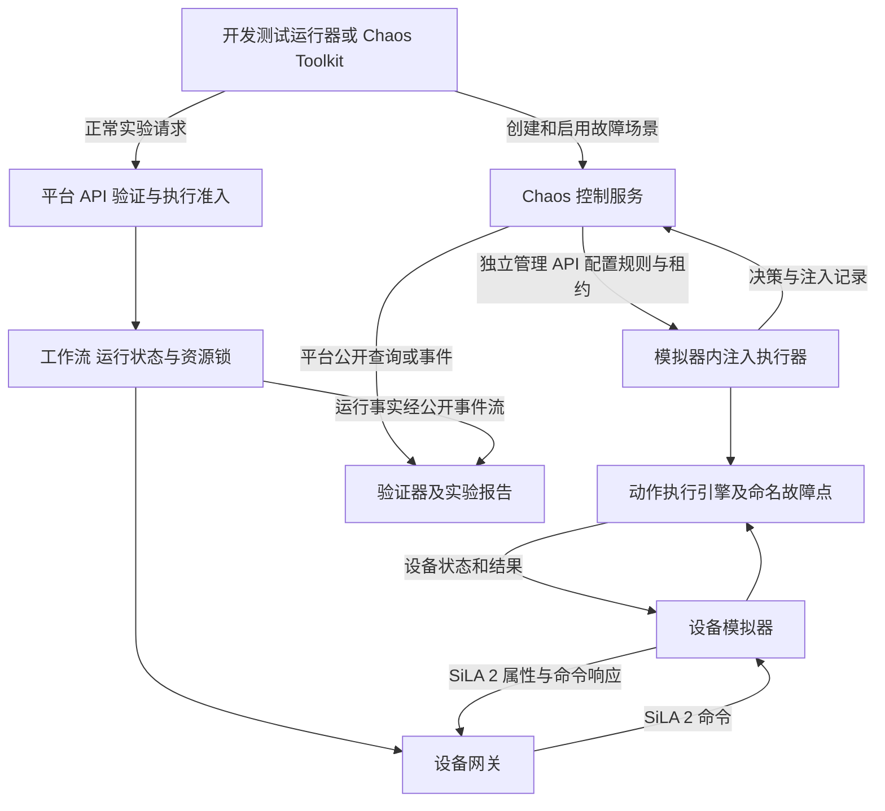

# 智能实验室 Chaos 子系统设计

状态：待实现设计，版本 0.1，2026 年 10 月 16 日。

Chaos 子系统用于给模拟设备动作注入可控故障，并验证故障经过 SiLA 2、网关和工作流后的系统行为。采用独立的 Chaos 控制服务管理场景、规则和验证结果，模拟器内的注入执行器执行具体异常行为。支持函数装饰器、自定义故障函数、概率触发，以及多动作和多设备关联场景。

本文描述目标设计。当前仓库只有单设备 normal、delay、fail 三种一次性模式，尚未实现独立 Chaos 服务、概率规则、装饰器和关联场景。已有实现与迁移见最后两节。

## 目标与范围

首期提供命名动作故障点、注册式异常行为、可复现的概率判定和有状态场景。测试人员能说明“在哪个动作、什么阶段、什么条件下、以多大概率执行哪种异常”，并拿到实际触发及系统响应的证据。

Chaos 场景运行称为 `chaosRun`，正常实验运行称为 `experimentRun`，二者独立关联。Chaos 只拥有故障场景的生命周期，不接管实验运行状态、排程、设备资源锁或异常恢复决策。

首期仅注入虚拟设备行为。真实适配器不加载注入执行器，Agent 和浏览器不直连设备、模拟器管理接口或消息总线。故障场景可以影响模拟动作，但不能成为绕过平台准入的设备控制入口。

## 系统结构与交互边界



图中的管理 API、Chaos 事件和运行事件为待定义接口。当前网关的 observations 缓存只是开发快照，不充当可靠事件流。

控制服务不下发移液、移动、检测等设备命令。测试运行器通过平台提交实验，平台准入后由工作流执行。控制服务只向模拟器配置故障，读取平台公开状态并收集注入证据。平台日常运行不依赖 Chaos 服务在线。

| 组件 | 职责和数据所有权 | 入口 | 外部依赖 |
| --- | --- | --- | --- |
| Chaos 控制服务 | 场景版本、规则版本、chaosRun、关联状态、租约、决策日志和测试报告 | 场景管理、生命周期及结果查询 API，注入记录接收入口 | 模拟器管理 API、平台查询 API、后续公开事件流、自有存储 |
| 模拟器内注入执行器 | 已确认的规则快照、本设备故障点、决策去重、故障实例和待上传记录 | 动作装饰器、阶段检查点、模拟器管理 API | 本地动作引擎、控制服务提供的版本化契约 |
| 模拟器动作引擎 | 设备、样品的模拟状态及动作结果 | 原有 SiLA 2 Feature 的设备侧实现 | 注入端口；协议 SDK 留在入口和基础设施层 |
| 测试运行器 | 提交实验、关联两个运行 ID、等待并展示测试结果 | CLI 或 Chaos Toolkit 扩展 | 平台 API、Chaos API |

控制服务与模拟器分别拥有自己的数据，不共享表，不跨进程导入源码。Chaos 领域逻辑不放入 `packages/`；模拟设备特有故障保留在对应模拟器，模拟器通用注入机制可放在 `simulators/runtime/`。

## 函数故障点与异常行为

### 故障点

故障点使用稳定业务名称，例如 `robot.move`、`liquid_handler.aspirate`、`measurement.acquire`，不依赖 Python 模块路径。装饰器只标记动作并进入注入端口，具体规则通过运行时配置提供。

动作上下文至少包括设备 ID、实验运行 ID、逻辑步骤 ID、样品 ID、命令 ID、逻辑重试序号、故障阶段和规则快照版本。不存在的上下文字段不参与匹配；依赖该字段的规则在场景准备时拒绝绑定到不支持的设备。

### 自定义异常行为

下例是拟议接口，尚未实现，不属于现成开源框架 API：

```python
@fault_behavior("liquid_handler.insufficient_volume", version="1")
def insufficient_volume(ctx, proceed, volume):
    actual_volume = volume * ctx.fault_parameters["ratio"]
    ctx.device_model.aspirate(actual_volume)
    return ActionResult.failed(
        code="INSUFFICIENT_VOLUME",
        details={"requested": volume, "actual": actual_volume},
    )


@fault_point("liquid_handler.aspirate")
def aspirate(ctx, volume):
    ctx.device_model.aspirate(volume)
    return ActionResult.succeeded()
```

规则引用 `liquid_handler.insufficient_volume@1` 并传入 ratio；故障函数可改变模拟设备状态、返回失败、生成偏差结果或按约定抛出模拟领域错误。`proceed` 是原动作的受控调用入口，一个动作调用最多允许执行一次。替换故障已经执行部分模拟动作时，不再自动调用原动作；延迟故障可以等待后调用原动作一次。

行为函数由可信本地代码注册。管理 API 只接受注册名称及校验后的参数，禁止上传可执行 Python、任意 import 路径或远程代码。未注册行为、参数不兼容或行为版本不一致会使场景准备失败。

### 注入阶段

| 阶段 | 用途 | 示例 |
| --- | --- | --- |
| before | 原动作开始前施加影响 | 延迟、动作拒绝 |
| replace | 用异常动作替换原动作 | 吸取量不足、机器人拒绝移动 |
| checkpoint | 动作内明确阶段注入 | 移动到 50% 卡住、吸液后喷头堵塞 |
| after | 原动作完成后修改响应或结果 | 检测结果偏移、完成响应丢失 |

函数入口装饰器不能自动知道动作内部进度。长动作必须显式调用 `fault_checkpoint(ctx, "mid_motion")` 等检查点。checkpoint 和 after 故障不能把已经完成的动作伪装成从未发生，注入记录与设备模型都保留实际效果。

## 规则与概率判定

一条规则由目标、前置条件、触发器、概率、行为和限制组成。以下为目标契约示例，不是当前管理 API 的请求格式：

```json
{
  "schemaVersion": "1.0",
  "scenarioId": "transfer-fault",
  "scenarioVersion": 1,
  "seed": "lab-seed-42",
  "rules": [
    {
      "ruleId": "aspirate-shortage",
      "target": {
        "deviceId": "liquid-handler-1",
        "action": "liquid_handler.aspirate",
        "phase": "replace"
      },
      "trigger": {"type": "each_new_command"},
      "probabilityPpm": 100000,
      "behavior": {
        "name": "liquid_handler.insufficient_volume",
        "version": "1",
        "parameters": {"ratio": 0.6}
      },
      "maxTriggers": 1,
      "scope": "chaosRun",
      "priority": 100
    }
  ]
}
```

`probabilityPpm` 为 0 到 1000000 的整数，100000 表示每个符合条件的新判定有 10% 概率命中，不保证每十次恰好一次。`maxTriggers` 是命中次数上限，与概率独立；达到上限后不再注入。

支持的触发条件按阶段实现：每个新命令、第 N 个匹配命令、指定检查点、逻辑时间窗口、前置故障或业务事件。首期落地前两种及命名检查点；跨设备事件条件在关联场景阶段提供。

判定顺序固定为：检查场景与租约 → 匹配目标和上下文 → 检查阶段及前置状态 → 检查次数预算 → 概率判定 → 原子预留命中额度 → 执行行为 → 记录结果。

相同故障点和阶段默认只选择一个行为。规则按显式 priority 选择，优先级相同且作用范围重叠时拒绝场景配置，不依赖配置文件顺序。组合行为需要显式声明执行顺序及兼容性，例如“先延迟、再执行替换故障”；不隐式叠加多个 replace。

### 可复现与幂等

不使用进程全局 `random()` 顺序决定命中。把 seed、场景版本、规则 ID、设备 ID、逻辑步骤 ID、逻辑重试序号、阶段及检查点出现序号按固定顺序规范化为 UTF-8 JSON，计算 SHA-256。取前 64 位无符号整数 u，按 `u × 1000000 < probabilityPpm × 2^64` 判断命中，避免浮点比较差异。

逻辑步骤标识来自同一实验计划的稳定路径，不能使用每次执行随机生成的 run UUID 替代。场景配置冻结后不得原地修改；记录配置摘要和判定算法版本。固定输入可复现单次判定；跨设备事件先后顺序还需要事件记录回放，不能仅凭 seed 保证。

命令投递重试与逻辑动作重试区分处理：相同 commandId 的重复投递返回已有判定或结果，不重新抽样，不再次消耗额度。真正的动作重试由工作流生成新的命令及逻辑重试序号，是否重新抽样由冻结场景规则声明。场景终止后仍保留其幂等记录至约定保留期结束。

## 多动作和多设备关联

### 因果故障

“A 故障后，B 才可能故障”由场景状态机表达。边只声明启用关系和匹配条件，不把 A 的整个故障记录复制给所有 B。

例如同一 sampleId 下，移液量不足 → 激活检测偏差规则 → 下一次匹配检测以 80% 概率产生偏低结果。不同样品不继承故障。前置事件使用 eventId 去重，以 causationId 追溯来源。

### 共同原因

气源压力不足等共同原因在 chaosRun 或指定资源作用域内只判定一次，产生共享故障实例。移液、清洗等后续动作读取同一实例，按各自已注册的影响函数改变行为，不为每个动作独立抽取“气源是否失效”。

如果共享故障已失效，后续动作恢复正常；故障期间已造成的样品体积变化继续存在。涉及多个模拟器时，控制服务拥有共同原因实例与版本，通过管理契约分发，设备只持有本地确认副本。

### 时间和顺序关联

连续故障窗口、先延迟再断线、并行设备异常，均由场景阶段和显式转换表达。默认使用模拟逻辑时钟，记录时钟来源和速率；网络租约使用独立单调实时时钟，不能因虚拟时钟暂停而永久有效。

第一版关联场景只允许有向无环图，拒绝环路、缺失前置节点和无终止条件。需要循环故障时，以有上限的重复次数明确展开。

### 跨进程一致性

全局 maxTriggers、共享实例和因果状态由控制服务通过版本号及原子更新裁决。模拟器按 `decisionId` 请求并缓存已确认的关联判定；本地普通概率规则可以离线计算，跨设备关联规则必须获得当前状态及额度确认。

记录接收采用至少一次交付，消费端按 eventId 去重。控制服务先持久化决定和额度，再返回决定；回应丢失后用相同 decisionId 重取。额度预留后设备掉线时标记执行结果 unknown，不直接退还额度，以免同一故障在其他设备重复执行。乱序事件按各聚合的 sequence 处理，缺口等待补齐或使场景降级，不以接收先后伪造因果关系。

跨设备管理接口不承诺同时生效。需要共同起点时，先完成所有目标的准备确认，再分发同一逻辑起点；要求严格同步的场景若无法达到约定屏障，则不启动实验。

## 生命周期与恢复

Chaos 运行状态为 `draft → prepared → armed → running → stopping → completed`，异常进入 `failed` 或 `cleanup_required`。这些状态只描述故障场景，平台实验仍由工作流独立管理。

1. 创建并校验场景，固定版本、seed、目标范围、持续时长和触发预算。
2. 查询模拟器公开故障点目录，检查行为版本、设备类型、检查点和上下文兼容性。
3. 各目标准备规则快照，返回摘要；全部确认后进入 armed，规则只匹配绑定的实验运行，不能影响其他实验。
4. 测试运行器经平台正常准入提交实验，并按绑定协议激活场景。需要在首个动作之前注入时，平台与工作流必须提供准入后、派发前的启动屏障；当前 v1 尚无此能力，不能用“提交后快速配置”替代。
5. 模拟器执行故障并上报记录，控制服务推进关联状态，验证器通过公开平台事实检查预期行为。
6. 结束、超时或人工停止时撤销规则和共享故障，等待各目标清理确认，汇总验证结果。

规则带有有界租约。控制服务不可达或租约到期后，不再启动新的注入；已生效故障按行为声明的恢复策略处理。延迟等待应可取消，持续偏差应撤销，已发生的模拟动作和样品变化不可简单回滚。执行中的故障不接受规则热替换。

停止 Chaos 不等于停止实验。若需停止设备动作，测试运行器必须通过平台控制请求交由工作流处理；Chaos 服务不得自行释放工作流资源锁。设备断线或执行结果不明时，工作流保持 unknown 和资源预留，直到按其恢复流程确认。

清理未收到确认时进入 cleanup_required，报告未清理的设备及规则版本；未确认清理或租约失效的模拟器不能参与新场景。模拟器重启清除易失规则、改变实例 epoch，并使旧租约失效；控制服务将未确认的故障执行记录为 unknown，不自动重放设备动作。

## 管理接口与事件契约

以下为待建设计，正式实现前在 `contracts/` 中新增定义，不覆盖现有 v1 管理语义。

| 所属方 | 拟议接口 | 语义 |
| --- | --- | --- |
| Chaos 服务 | `POST /v1/scenarios` | 创建不可变场景版本及内容摘要 |
| Chaos 服务 | `POST /v1/chaos-runs` | 创建场景运行，确定目标、seed 和预期验证 |
| Chaos 服务 | `POST /v1/chaos-runs/{id}/prepare` | 校验所有目标能力并准备规则 |
| Chaos 服务 | `POST /v1/chaos-runs/{id}/arm` | 确认绑定、配置摘要及启动屏障 |
| Chaos 服务 | `POST /v1/chaos-runs/{id}/stop` | 幂等撤销故障，不直接控制实验设备 |
| Chaos 服务 | `GET /v1/chaos-runs/{id}` | 返回场景状态、注入记录、清理及验证结果 |
| Chaos 服务 | `POST /v1/chaos-runs/{id}/decisions` | 对关联规则作原子裁决，同 decisionId 返回同决定 |
| Chaos 服务 | `POST /v1/chaos-runs/{id}/records` | 幂等接收模拟器决策、执行及清理记录 |
| 模拟器管理 | `GET /v2/fault-points` | 返回故障点、阶段、行为版本及参数格式 |
| 模拟器管理 | `PUT /v2/chaos-runs/{id}` | 按版本和摘要安装或续租冻结配置 |
| 模拟器管理 | `DELETE /v2/chaos-runs/{id}` | 幂等撤销配置，返回清理结果 |

变更请求携带幂等键；重复请求内容摘要不同返回冲突。非法规则或不支持能力返回校验错误，失效版本与跨环境目标拒绝执行。管理入口与设备 SiLA 2 执行入口分离；正式接入时控制凭证限定为模拟测试环境和明确目标清单。

建议的契约归属为 `contracts/api/chaos/`、`contracts/api/simulator/`、`contracts/schemas/chaos/` 和 `contracts/events/chaos/`。这些路径表示后续归属，不代表目录内已有正式接口。

Chaos 事件信封包含 eventId、aggregateId、sequence、occurredAt、receivedAt、correlationId、causationId、schemaVersion 和 payload。payload 包含 chaosRunId、规则版本、decisionId、experimentRunId、stepId、commandId、deviceId、sampleId、阶段、命中结果、行为版本、故障参数及实际效果。未命中也记录原因，例如作用域不匹配、概率未命中、预算耗尽或租约过期。

为了绑定逻辑步骤与故障作用域，需演进平台计划交付、网关命令及设备命令上下文契约。跨设备、跨样品的关联上下文不能只从 `{runId}:index` 推导。当前 Execute 只有 CommandId 和 DurationMs，不能声称已支持这些字段；应在兼容的新命令或新 Feature 版本中明确传递，不手改生成代码，也不让服务读取其他服务数据库补齐上下文。

## 故障结果与验证

故障触发成功和系统韧性验证通过分别统计。注入器产生预期故障后，工作流错误地继续执行仍算场景验证失败。反之，概率没有命中时，实验正常完成不算故障处置验证通过。

报告分别给出注入执行状态、验证状态和清理状态。验证状态为 passed、failed 或 inconclusive；未命中、证据丢失、步骤未执行或清理结果不明均不能自动标记 passed。

| 场景 | 注入证据 | 系统预期 |
| --- | --- | --- |
| 动作延迟 | before 或 checkpoint 的延迟开始及结束记录 | 进度可观察，超时策略按工作流规则执行 |
| 动作失败 | 行为执行记录及 SiLA 2 失败结果 | 工作流停止不应继续的后续步骤 |
| 执行成功但响应丢失 | after 阶段记录设备已完成，传输代理记录丢弃响应 | 进入结果不明处置，相同命令不重复动作 |
| 同一样品的连续影响 | 共享 sampleId、前置事件及因果记录 | 关联只影响匹配样品，不污染其他样品 |
| 多设备共同原因 | 同一共享故障实例及各设备确认记录 | 目标动作按约定受影响，撤销后新动作恢复 |

响应丢失、网络隔离和进程终止需要通信代理或进程注入扩展；仅返回 `{state: failed}` 不能替代这些场景。真实设备也遵循 SiLA 2 契约，但不接收本设计的模拟故障规则。

## 开源框架的使用方式

| 项目 | 已有能力 | 本系统的使用方式 |
| --- | --- | --- |
| [Chaos Toolkit](https://chaostoolkit.org/reference/api/experiment/) | Python、HTTP、进程活动，检查、顺序编排和回滚活动 | 优先作为测试运行器的可选外层入口，调用 Chaos 服务；关联状态和设备故障行为由本系统实现 |
| [Latch chaos](https://github.com/sangaraju1988/latch#chaos-testing) | 函数装饰器、失败概率、延迟和种子 | 可作为简单函数注入的参考；不假定其具备本系统所需的设备状态与跨动作关联 |
| [ChaosBlade Python](https://github.com/chaosblade-io/chaosblade-exec-python) | 运行时函数拦截、延迟、异常和返回值修改 | 后续评估通用依赖调用故障，设备动作仍使用显式注册故障点 |
| [Chaos Mesh](https://chaos-mesh.org/docs/create-chaos-mesh-workflow/) | Kubernetes 故障及串行、并行、条件编排 | 有 Kubernetes 部署需求后评估基础设施场景 |

选用独立领域控制服务，是因为场景需要样品、动作阶段、命令幂等和共享故障实例这些业务语义。通用框架负责实验执行或基础设施注入，通过端口接入；不把其 SDK 放进领域层。上述项目均尚未接入仓库。

## 目录与实施阶段

计划新增 `services/chaos-service/`，遵循 domain、application、ports、infrastructure、interfaces 分层。领域层定义规则、判定、预算和关联状态；应用层处理准备、启用、停止、记录及报告；端口定义模拟器管理、平台查询、时钟和存储；基础设施实现 HTTP、持久化与可选框架集成。

模拟器注入执行器与控制服务通过契约通信，不导入该服务源码。故障函数留在 `simulators/<device>/`，通用故障点包装、检查点及本地去重留在 `simulators/runtime/`。本次仅形成设计，不创建服务空壳、依赖清单或部署配置；实现时再选择并验证具体 HTTP 和存储技术。

| 阶段 | 交付 | 验收重点 |
| --- | --- | --- |
| 第一阶段 | 独立控制服务、单模拟器、注册式行为、before/replace/checkpoint、概率和记录 | 能注册自定义函数，0% 从不命中、100% 总命中，相同逻辑输入判定一致 |
| 第二阶段 | 运行绑定与启动屏障、规则租约、持久化幂等、停止和清理 | 首个动作可被正确注入，重复请求不增加故障次数，控制服务掉线后租约收敛 |
| 第三阶段 | 样品作用域、因果图、共同原因、跨设备原子预算 | 同样品关联生效，其他样品不受影响，乱序和重复事件不改变既定决定 |
| 后续扩展 | 传输故障、Chaos Toolkit 扩展、需要时接入基础设施框架 | 响应丢失与业务失败可区分，结果不明时不重复设备动作 |

组件单元测试分别验证纯判定、规则冲突、预算、状态转换和故障行为。跨组件测试只走公开接口，覆盖概率统计、幂等、并发额度、配置准备失败、租约失效、进程重启、关联事件去重、清理失败及验证报告。概率统计使用固定样本和预先确定的容差，不能把短样本频率偏差当作算法错误。

## 与当前实现的衔接

当前 [模拟引擎](../../simulators/runtime/engine.py) 在下个命令领取模式后立即恢复 normal；delay 固定在 50% 等待 500ms，fail 固定在 50% 返回 failed。当前 [管理 API v1](../../contracts/api/simulator/management-v1.md) 只接受 mode，不接受本文的场景 JSON。

迁移时把 delay 和 fail 提取成注册行为，保留原有 v1 语义；新增 v2 场景管理接口并明确互斥，已有场景占用时拒绝 v1 模式修改。现有 SiLA 2 Feature 保持可用，新增上下文能力单独版本化。现有六组集成测试只验证最小通信链路，不能视为本文目标能力的验收。

设计依据为 [服务边界](service-boundaries.md)、[最小交互运行说明](../development/interaction-demo.md) 与 [当前 SiLA 2 契约](../../contracts/sila2/README.md)。
