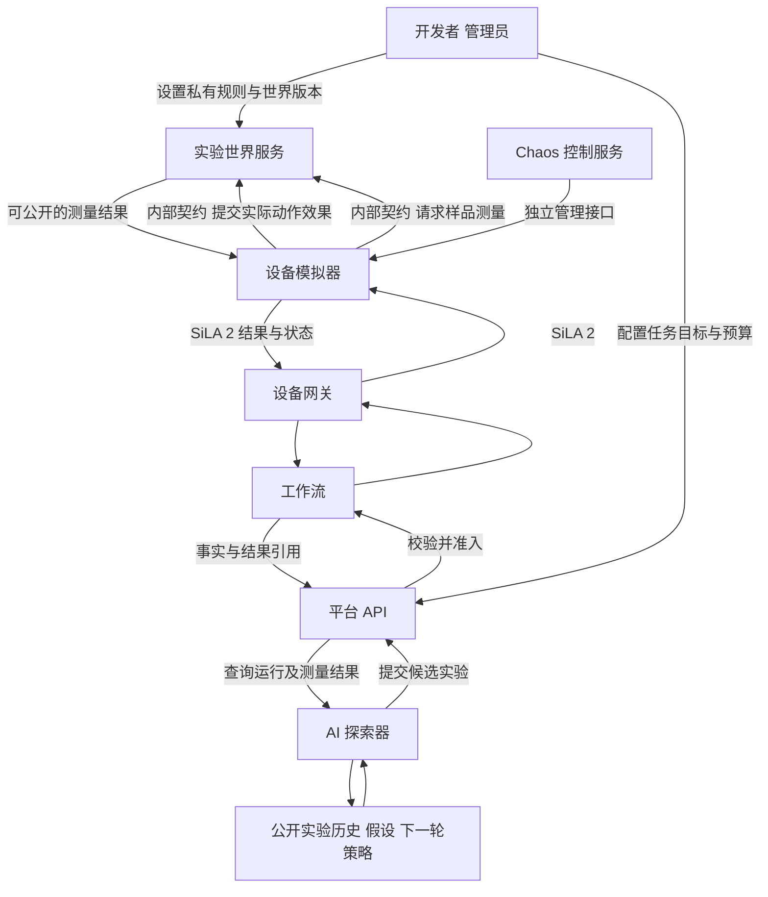

# 隐藏规律实验环境与 AI 闭环探索设计

状态：待实现设计，版本 0.1，2026 年 10 月 16 日。

核心目标是让 AI 通过实际下发实验、取得测量结果并调整后续方案，逐步找到能够产生目标产物的实验条件。实验环境由开发者预设隐藏规律，AI 只能看到公开的操作空间和实验反馈。环境在一次探索任务中保持固定，改变的是 AI 的假设、实验方案和探索策略。

这套系统称为实验世界服务 `experiment-world`。它决定虚拟实验“在什么条件下产生什么产物”；设备模拟器负责动作执行与设备状态；Chaos 负责故障和扰动。三者组合后，可以分别评估发现规律的能力和面对故障时继续探索的能力。

当前仓库已实现的通信演示只包含 durationMs 动作和状态回传，尚不具备材料、反应、产物测量或 AI 自动探索能力。本文是目标设计，不表示已有上述服务或业务验收结果。

## 任务目标与成功定义

默认向 AI 公开实验目标，例如“在最多 30 次已准入实验内，找到目标产物比例高、纯度达标且成本受限的配方”。允许的原料、参数范围、单位、设备能力、预算和结果字段也公开。隐藏的是这些输入与产物之间的真实映射、最优条件、反应参数及评测答案。

需要区分两类任务：

| 类型 | AI 需要完成的事情 | 主要验收方式 |
| --- | --- | --- |
| 产物优化 | 找到更好的实验条件并重复获得目标产物 | 预算内最佳有效产物、达标次数、独立复测表现 |
| 规律辨识 | 提出能解释和预测实验结果的规律或模型 | 未见条件上的预测误差、对照实验和反事实预测 |

首期以产物优化为主，允许 AI 输出规律假设，但不要求它准确恢复隐藏公式。多个不同规则可能给出相同有限观测；“逐渐获得目标产物”不能直接证明“已经发现真实规则”。

这里的自演化首先指实验策略和知识状态随观测更新，不涉及在线修改模型权重、自动改写服务代码或修改世界规则。

## 系统交互



AI 没有实验世界内部接口、模拟器管理接口或设备连接工具。AI 的每一次实验都经过平台验证和执行准入，工作流仍是运行状态和资源锁的唯一写入方。孪生仍只维护查询投影。

世界服务只处理由注册模拟器提交、绑定已准入命令的动作效果与测量请求，不能把它暴露成 AI 免费查询任意配方得分的函数。平台或 Agent 不通过隐藏规则提前筛选“哪个实验能成功”。平台拒绝越界参数时使用公开设备和任务约束，不泄露隐藏反应条件。

## 组件职责与数据所有权

| 组件 | 负责并拥有的数据 | 入口与外部依赖 |
| --- | --- | --- |
| experiment-world | 私有规则版本、世界实例、虚拟样品化学状态、动作效果账本、产物真值、测量实现与随机流 | 管理端私有 API，模拟器内部效果和测量 API，自有存储 |
| 设备模拟器 | 设备姿态、动作进度、执行事实、已完成命令与实际动作偏差 | SiLA 2，世界内部 API，模拟器管理 API |
| agent-service 内的探索模块 | 公开实验历史、假设版本、候选方案、策略决策及模型调用记录 | 仅平台公开实验与查询 API，模型调用由基础设施端口实现 |
| platform-api | 公开任务目标、探索会话授权、参数范围、预算账本、规格版本、准入与结果发布记录 | Agent API 入口，工作流契约，自有存储 |
| workflow-worker | 实验计划、运行状态、资源预留、命令关联与异常处置 | 网关命令及事件契约 |
| 管理端评测模块 | 不向 AI 开放的基准、最优值或有效见证、对照实验和跨任务统计 | 世界私有评测端口、平台公开结果的只读副本 |

世界中的样品状态仅属于模拟实验，不替代真实样品系统。模拟器报告“实际转移了多少、加热了多久”，世界据此更新样品组成和反应状态；模拟器不再独立维护另一份权威化学组成。样品位置投影与设备资源锁仍归既有边界处理。

世界服务不得直接修改工作流记录、跨服务读取数据库或主动发设备命令。各方只通过 `contracts/` 定义的 API 或事件传递 ID、版本和数据。

## 隐藏规律模型

### 输入与输出

首期用一个可参数化的虚拟反应体系，支持原料比例、温度、反应时长和加料顺序。公开参数具有明确单位和范围，例如温度使用 °C、时长使用 s、比例采用归一化体积分数；哪些值可控由任务版本固定。

私有规则可以组合以下机制：

- 可行窗口：某个区间或前置操作决定反应能否发生。
- 连续响应：比例、温度和时间改变产率、纯度或副产物。
- 参数交互：单独增加 A 或 B 没有收益，二者结合才形成目标产物。
- 过程依赖：先混合后加热与先加热后混合得到不同状态。
- 历史依赖：同一样品的先前反应影响下一步，不能只看最后一条命令。

这些规则由可校验、带版本的配置组合成纯领域计算，不使用大模型临时编造产物。规则需要满足所选虚拟体系的定义域、量纲、质量或体积约束；它是用于测试探索能力的合成环境，不自动代表经过科学验证的真实反应模型。

输出分为两层：私有真值包括产物组成、真实产率和潜在状态；公开测量包括可检测的产物信号、估计比例、纯度、单位、检测限、不确定度及质量标记。AI 只取得该任务允许观测的字段。

### 难度与信息量

按公开可观测性分级：先提供无噪声连续测量，再加入噪声、多个局部最优、参数交互和过程历史。首期避免整个搜索空间绝大部分都返回完全相同的零值，否则有限预算下无法区分策略好坏。

若特意设计稀疏成功窗口，任务应提供可用的中间测量或足够探索预算，并作为独立难度等级。管理员在发布前验证至少存在一个满足目标的方案；已知方案及最优值保持私有，不交给 AI。

## 规则对 AI 的隔离

“不告诉 AI”需要运行边界，不能只靠提示词约定。

| AI 可见 | 仅管理员和环境进程可见 |
| --- | --- |
| 任务目标、操作空间、单位、公开成本和预算 | 规则公式、系数、真实最优点及发布前见证方案 |
| 自己获准执行的实验、测量反馈及公开设备状态 | 未测量样品真值、潜在状态、测量随机种子 |
| 当前任务允许使用的公开知识 | 私有规则配置、参考答案、内部日志和管理 API |

私有配置放在独立环境进程或容器的受控存储中，运行中的 AI 没有其文件系统、Shell、网络端点或凭证权限。给拥有全仓库读取权限的编码 Agent 开放规则文件，不能视为真正的隐藏规则评测。

任务发布时检查工具清单、检索索引、日志、错误详情、结果序列化和可下载附件，防止私有规则进入 Agent 上下文。世界版本与样本种子分离，测量接口不返回公式、梯度、未测点结果或最优配方。文档中的示意机制可以公开，正式评测使用独立私有参数与未见规则组合。

## AI 探索闭环

```text
读取公开目标和预算
    ↓
整理已有实验与当前假设
    ↓
提出下一组实验及选择理由
    ↓
平台校验 授权范围 预算准入
    ↓
工作流执行 模拟设备产生实际效果
    ↓
世界计算产物 检测动作产生公开测量
    ↓
AI 更新假设 选择探索或复测
    └──────────→ 下一轮
```

每轮记录候选参数、所依据的已完成结果、假设版本、预期改善、实际测量和下一步理由。未完成实验不被当作已有证据。策略可在粗搜索、局部改善、参数对照、重复测量之间切换，不把所有轮次固定成微调某一个参数。

探索模块运行在 agent-service 内，负责提出方案与解释结果。平台独立执行授权和预算检查；即使模型建议超过预算、调用隐藏工具或改写实验约束，也不会得到新的执行权限。

AI 提出“最佳配方”后安排独立样品复测，避免把一次噪声高值当作稳定产物。复测占用预算；达到目标、预算耗尽、达到总时限或授权撤销时结束。连续生成无效方案也有提案次数上限，不能无限空转。

### 有界自动执行

预先授权的探索会话必须固定任务版本、可用设备、参数边界、最大已准入实验数、费用或耗材限额及有效期。在这个范围内允许多轮自动准入；超出范围仍走平台已有审批流程。Agent 不能自行扩大授权。

平台在准入时原子预留预算，并为每个逻辑实验保留幂等键。命令投递重试不重复扣费；真正新做一次实验或新做一次测量需要新的预算项。设备失败、部分执行和检测失败产生的实际成本按任务公开规则结算，不能把失败实验自动变成免费探索。

## 世界状态与测量语义

同一世界实例冻结规则版本、任务版本和测量模型版本。世界发生变化时新建版本和独立评测任务，不把目标函数漂移混进普通学习曲线；需要研究适应变化时单列任务。

动作效果以 effectId、commandId、sampleId、样品版本和步骤顺序提交。世界原子提交效果并保存响应；相同效果重送返回已有结果，同 ID 不同内容拒绝。样品版本冲突时停止推进并对账，不按网络接收先后擅自重排动作。

部分失败也可能改变样品：少吸取了体积、加热一半中止，都先提交实际发生的效果再报告动作失败。只有效果是否发生尚不明确时才标记 unknown，等待工作流与网关按公开事实确认，不能直接重做并覆盖原状态。

化学状态变化与仪器读取分开建模。新 measurementId 表示一次新的受预算约束的测量；重试读取同一 measurementId 返回同一已保存的观测，不重新抽噪声。重新取样或重复检测生成新 ID，按冻结的独立随机流产生观测。相同名义配方的独立样品可以有不同过程噪声，所有噪声分布与种子仅对管理员可重现。

公开结果区分正常检测、低于检测限、设备故障、测量缺失与执行结果不明。故障不能统一写成“产率为零”，否则 AI 会学习到错误的反应规律。

## 与 Chaos 的组合

先在 Chaos 关闭的条件下评估策略是否能找到目标产物，再叠加扰动评估韧性。规则真值、过程噪声、测量噪声和注入故障分别记录，便于解释性能变化。

| 因素 | 修改位置 | 对 AI 的反馈 |
| --- | --- | --- |
| 隐藏产物规律 | 世界内部化学模型 | 按测量模型返回实验产物 |
| 自然过程噪声 | 世界状态演进 | 独立样品之间存在合理差异 |
| 测量噪声 | 检测观测生成 | 有不确定度的测量值 |
| 实际加料不足 | 模拟器动作效果 | 世界按实际量更新，检测结果随之改变 |
| 响应丢失或设备断线 | 协议或进程故障 | 平台报告缺失或 unknown，不伪造化学结果 |

同一物理偏差只施加一次。若模拟器已经把名义 10mL 改为实际 6mL，世界使用 6mL 计算，不能再乘一次故障比例。Chaos 的私有注入记录不默认进入 AI 上下文，公开设备告警是否可见由任务的可观测性规则统一决定。

## 契约与接口规划

以下是待定义契约，不表示当前已有对应路由。

| 所属方 | 拟议接口 | 调用方及内容 |
| --- | --- | --- |
| 世界管理端 | `POST /v1/world-definitions` | 管理员创建私有规则版本并校验可达性 |
| 世界管理端 | `POST /v1/world-instances` | 管理员创建隔离实例，冻结规则与种子 |
| 世界内部 | `POST /v1/effects` | 注册模拟器提交绑定已准入命令的实际动作效果 |
| 世界内部 | `POST /v1/measurements` | 检测模拟器为已准入检测命令创建或获取测量 |
| 平台公开 | `POST /v2/exploration-sessions` | 创建具有公开目标和有界授权的探索会话 |
| 平台公开 | `GET /v2/exploration-sessions/{id}` | AI 查询任务、预算和自己可见的实验历史 |
| 平台公开 | `POST /v2/experiments` | AI 提交 sessionId、配方和过程步骤 |
| 平台公开 | `GET /v2/runs/{id}/results` | 返回可公开的实际参数、测量记录和质量状态 |

世界内部 API 由服务身份及绑定命令校验保护，commandId 本身不等于授权。测量不能接收任意配方直接返回分数，必须引用实际演进的样品版本和检测命令。

计划在 `contracts/api/experiment-world/`、`contracts/schemas/experiment-world/` 定义内部契约，在平台自有 API 和 schema 目录定义探索会话、实验输入和公开结果。设备动作能力归 `contracts/sila2/`，与真实适配器共用。公开契约只描述可交换格式，不包含隐藏公式或参考答案。

现有 v1 规格只接受 deviceId 和 durationMs；材料、样品、单位、配方、加料顺序及结果结构需用新版本明确引入，不把它们偷偷塞入 durationMs 或改变既有字段含义。SiLA 2 命令与生成代码随正式 Feature 定义演进，生成代码不手改。

世界事件按统一信封携带 eventId、aggregateId、sequence、occurredAt、receivedAt、correlationId、causationId、schemaVersion 和 payload。公开事件与私有事件分流，私有真值不发布到 Agent、操作台或孪生可读的公共流。

## 评价 AI 是否在进步

以已消耗的实验次数或成本为横轴，观察最佳有效结果和达标率。公开目标函数只使用任务允许的测量字段；管理端可以额外用私有真值与参考最优值评估，但不把该私有评分回传给 AI 作为隐蔽的额外查询通道。

- 样本效率：首次得到有效产物、首次达标分别消耗多少次实验。
- 产物质量：预算内最佳结果及独立复测的均值、离散程度和合格比例。
- 成本效率：得到稳定合格结果所需的耗材、时间和实验费用。
- 策略利用证据的程度：是否减少无效重复，是否用对照实验检验假设。
- 泛化能力：相同算法在未见世界实例和私有规则组合上的表现。

对照采用公开预设流程与预算匹配的随机搜索。各策略使用相同公开任务、相同预算、预先确定的配对种子和多个独立世界实例；自适应策略执行顺序不同时，不能强求每轮噪声完全相同，应使用稳定的样品及测量随机流标识并记录差异。达到目标后的复测预算在所有策略中采用同一规则。

规律辨识任务另设隐藏测试条件，要求 AI 在观察答案前提交预测，再由管理端评测。不得只凭 AI 的文字解释判断学会了规律。任何收敛或优于基线的结论都以实际多次评测为准。

## 最小实施范围与验收

第一版先做一个虚拟反应、少量连续参数、单一目标产物和固定世界。AI 已知目标与参数范围，只能通过正常实验获得结果。关闭 Chaos 和测量噪声，跑通多轮记录与预算限制后，再逐步增加复杂度。

| 阶段 | 实现内容 | 验收重点 |
| --- | --- | --- |
| 第一阶段 | 私有规则引擎、单样品状态、公开检测结果、管理员配置 | 相同输入与种子可复现，动作顺序影响正确，私有规则不出现在公开结果 |
| 第二阶段 | 材料和检测协议、世界与模拟器通信、平台新规格与预算 | 每个结果可追溯至获准动作，无直接配方评分捷径，重复消息不重复改变样品 |
| 第三阶段 | AI 提案、执行、反馈、策略更新和独立复测 | 能有界运行完整闭环，保留每轮证据，不越权或超预算 |
| 第四阶段 | 多个隐藏世界、过程与测量噪声、对照评测 | 给出可重复的质量和样本效率指标，不预先承诺优于随机搜索 |
| 第五阶段 | 多动作关联与 Chaos 组合 | 化学低产和设备故障能区分，偏差不重复施加，结果不明时不重复实验动作 |

新服务计划目录为 `services/experiment-world/`，内部遵循领域、应用、端口、基础设施及入口分层。领域层处理规则与样品状态，应用层处理效果提交和测量事务，基础设施实现私有配置及独立存储。框架、数据库及模型 SDK 不进入领域层；开始实现后再增加可运行依赖和部署配置。

单元测试归各组件，覆盖规则边界、单位、顺序、守恒或约束、去重和噪声采样；跨组件测试通过公开契约验证动作到结果链路。隔离测试检查 Agent 的所有工具和响应不能访问私有配置；闭环评测另行验证探索效果。现有通信测试不能替代这些业务验收。

设计依据为 [服务边界](service-boundaries.md)、[Chaos 子系统设计](chaos-system-design.md) 与 [当前通信演示](../development/interaction-demo.md)。
